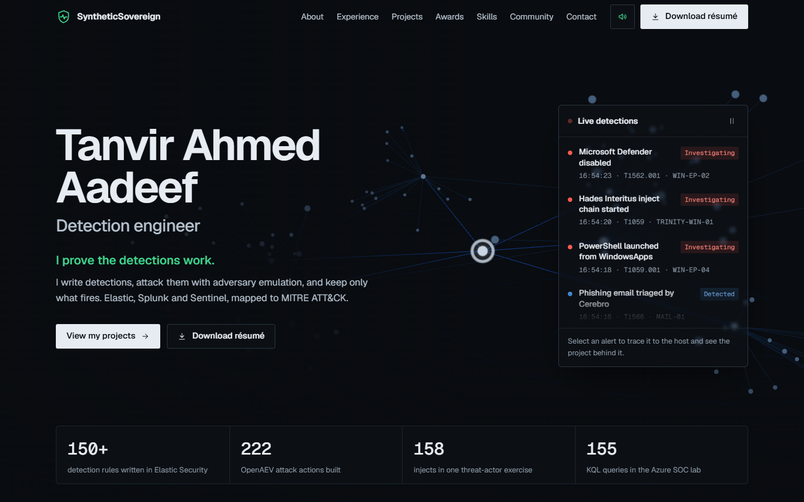
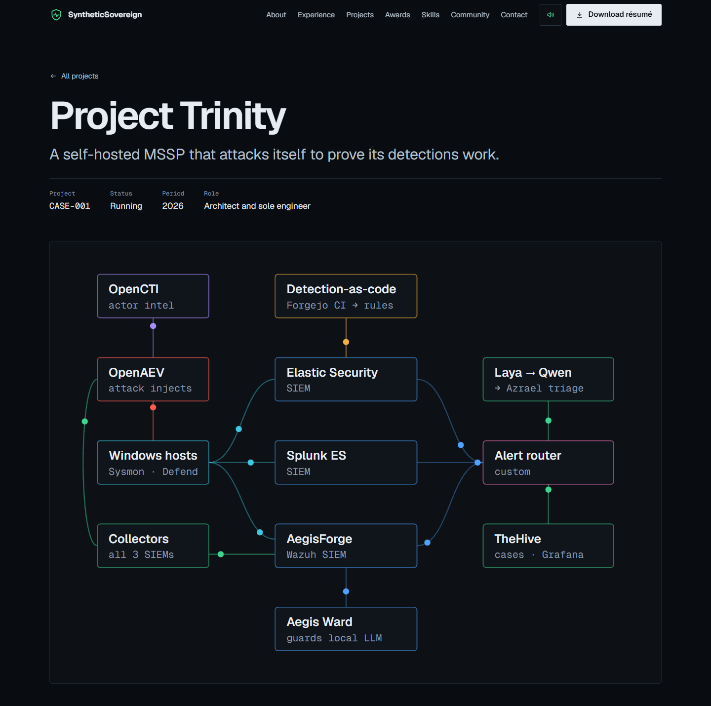

<div align="center">

<a href="https://tanvirahmedaadeef.com"></a>

<br>

<a href="https://tanvirahmedaadeef.com"></a>
<a href="https://www.linkedin.com/in/tanvir-ahmed-aadeef/"></a>
<a href="https://scholar.google.com/citations?user=YSsWnuUAAAAJ"></a>

</div>

## About

My personal portfolio. I'm a detection engineer in Melbourne: I write detections in Elastic, Splunk and Sentinel, attack them with adversary emulation, and keep only what fires. This site is where my work, projects and background live in one place.



## What's on it

| Section | What you'll find |
|:--|:--|
| **About** | Who I am, how I work, and what I do outside of work |
| **Experience** | Triskele Labs and La Trobe University |
| **Projects** | Six case studies, each with its own page, screenshots and diagrams |
| **Awards** | Recognition from La Trobe, NAB and Google Developer Groups |
| **Skills** | The tools I've used on the job and in my lab, plus certifications |
| **Community** | Mentoring, competitions and events I've been part of |
| **Timeline** | My path from university to detection engineering |

## Projects

| | Project | Summary |
|:--:|:--|:--|
| 🛡️ | [**Project Trinity**](https://tanvirahmedaadeef.com/work/trinity/) | A self-hosted MSSP on Kubernetes that attacks itself to prove its detections work |
| 🧱 | [**Aegis Ward**](https://tanvirahmedaadeef.com/work/aegis-ward/) | A security gateway that stops prompt injection before it reaches a local LLM |
| ☁️ | [**Azure SOC homelab**](https://tanvirahmedaadeef.com/work/azure-soc/) | A cloud SOC on Sentinel and Defender XDR, with case files, playbooks and risk reports |
| ⚡ | [**AEMO governance framework**](https://tanvirahmedaadeef.com/work/aemo/) | A 40-page cyber governance framework for the Australian Energy Market Operator |
| 🪙 | [**ElevateX**](https://tanvirahmedaadeef.com/work/elevatex/) | An ERC-20 token on Ethereum priced from a Chainlink gold feed |
| 🤖 | [**Cerebro**](https://tanvirahmedaadeef.com/work/cerebro/) | An AI assistant in Copilot Studio that works like a junior SOC analyst |



## Highlights

- **Live detection feed:** real alerts from my work stream into the hero. Select one to trace it to the host and the project behind it.
- **3D network:** a SOC network built in Three.js where attack packets go red, detections answer in blue, and hosts settle green.
- **Scroll-driven scenes:** the network breaks apart and re-forms into a new shape for each section as you scroll.
- **Trinity attack story:** scroll through one attack as it moves across the platform, from threat intel to a closed case.
- **Interface sound:** subtle synthesised sounds, which you can switch off.
- **Accessible:** keyboard friendly, with reduced-motion support and a fallback when WebGL isn't available.

## Built with

<p>


</p>

## Run it locally

You'll need [Node.js](https://nodejs.org) 22 or later.

```bash
git clone https://github.com/SyntheticSovereign/My-Portfolio-Site.git
cd My-Portfolio-Site
npm install
npm run dev
```

Then open http://localhost:4321.

<details>
<summary><b>Project structure</b></summary>

<br>

```
public/            résumé, share card, security.txt, headers
scripts/           build steps for the security policy and sitemap
src/
  data/site.ts     all the text and facts on the site
  components/      one component per section
  layouts/         page shell, navigation, meta tags
  pages/           home, project pages and 404
  scripts/         3D scenes, live feed, sound
  styles/          colours, type and global styles
  assets/          screenshots, logos and photos
```

</details>

## Contact

The best way to reach me is through the [contact section](https://tanvirahmedaadeef.com/#contact) on the site or on [LinkedIn](https://www.linkedin.com/in/tanvir-ahmed-aadeef/).

<br>

<div align="center">
<sub>© 2026 Tanvir Ahmed Aadeef. All rights reserved. No use, copying or AI training without permission. See <a href="LICENSE">LICENSE</a>.</sub>
</div>
